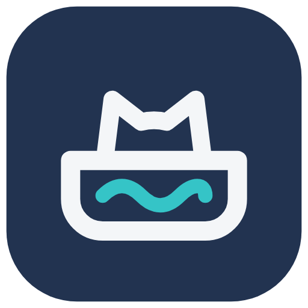

<p align="center"></p>

# Meowant

A Home Assistant custom integration for the Meowant self-cleaning litter box, built against Meowant's cloud API. See [the integration's README](custom_components/meowant/README.md) for installation.

**Status:** works with a Meowant SC-01. See the [changelog](CHANGELOG.md) for what's in each version and [`API.md`](API.md) for the protocol.

## What you get

**Per litter box** (one device):

| Type | Entities |
|---|---|
| Sensors | Waste bin level, Waste bin uses, Deodorant remaining, Last cat visit, Last visit weight, Last visit duration, Last clean, Status (live); diagnostic: Last device event, Auto-clean delay |
| Binary sensors | Online, Waste bin needs emptying, Deodorant expired |
| Buttons (live) | Clean, Level litter, Pause, Resume |
| Event | Activity: fires for each cat visit, scheduled clean or clean after a visit |

**Per cat** (one device each): Weight, Visits today, Time in box today.

*Live* entities use Meowant's MQTT channel, the same one the app uses for commands; everything else is polled over REST. What each entity shows is in [the integration's README](custom_components/meowant/README.md#what-you-get).

## Disclaimer

This is an unofficial client for personal use with an account and device the author owns. It is not affiliated with, endorsed by, or supported by Meowant. The upstream API is undocumented and can change without notice.

## Development

```
python -m venv .venv
.venv\Scripts\python.exe -m pip install -r requirements-dev.txt
.venv\Scripts\python.exe -m pytest tests/
```

Tests need no network and no Home Assistant install (see `tests/conftest.py`). The MQTT client and IM session are tested against an in-process fake broker.

### Dev console

A small local page for poking at the cloud API before it's wired into Home Assistant. Copy `.env.example` to `.env` and fill in your email and password (and country code, if not `US`), then:

```
.venv\Scripts\python.exe -m uvicorn backend.app:app --reload --port 8765
```

Open `http://localhost:8765` and log in once. The server keeps that session, so reloading the page doesn't log in again. From there:

- **State:** the box's settings, waste-bin counter, deodorant, online status, recent cat visits and device events, and cat profiles, shown as raw values. Refresh manually or every 5 or 30 minutes.
- **Actions:** reset the waste-bin counter, deodorant alert and "replaced", auto clean, and generic forms for feature switches and time windows.
- **Live:** connect to the MQTT channel, request the box's work state, send operations (clean, level, pause, resume, rise, drop, or any op mode/state), and watch decoded incoming messages: receipts, acks and the box's state pushes.
- **Request console:** send a signed, authenticated request to any path. `{serial}` fills in the selected box. Save a request as a custom button; buttons are stored in your browser.

Go easy on requests. Meowant's cloud has blocked a whole home connection, the phone app included, after heavy testing (see [`API.md`](API.md#rate-limiting)).

Tokens, emails and passwords are redacted from everything the page shows. The fake client install ID is persisted to `.dev_device_id` (gitignored).

## Repo layout

```
custom_components/meowant/   # Home Assistant integration
backend/ + frontend/         # local dev console (FastAPI + static HTML)
tests/                       # unit tests for the API client, parsing, and the IM/MQTT layer
_meowant_dev_import.py       # lets backend/ and tests/ reuse the HA-free modules without installing homeassistant
API.md                       # cloud API reference
CHANGELOG.md
```

## License

[MIT](LICENSE)
